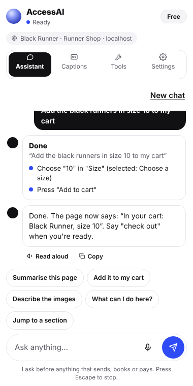

# AccessAI

**The web, on your terms.** AccessAI is an AI assistant that lets Blind, low-vision, Deaf and hard-of-hearing people read and shop on any website on their own terms. It sits in a browser side panel next to the page, explains it, answers questions from what the page actually says, does things for you step by step, and stops before money moves.

This first version rebuilds the prototype video (Sam, Mia and Grace) as a working Chrome extension and adds the safety and trust features from the launch doc.



## What works today

| Journey | What AccessAI does |
| --- | --- |
| **Sam** (Blind, screen reader) on Runner Shop | Summarises the page, answers "What does delivery cost?" with the quote it came from, describes the unlabelled product photo (labelled "AI description"), chooses size 10 and presses Add to cart while writing every step into the chat, then **stops at "Checkout and pay"** and hands over. |
| **Mia** (Deaf) on Harbour Health | Opens straight on Captions because that is her saved preference. Live captions in large, resizable text, unsure words underlined, transcript search with highlights, export, and a one-tap summary of dates and actions. |
| **Grace** (low vision) on the Seniors Card page | "Make the text bigger" scales the whole page (125%, 150%), high contrast (white on black, yellow links), a reading guide that follows the pointer and keyboard focus, a plain-English rewrite, and "reset the page" undoes it all. Changes are remembered per site. |

### Improvements on the prototype (from the launch doc)

- **Safety rules live in code, not in the AI prompt.** The action layer refuses to touch password, card, CVV, one-time code, bank, Medicare, TFN, passport or licence fields, refuses to press pay, place order, checkout or delete account buttons, and asks before anything that sends, submits or books. The API also strips any AI-planned step that targets those elements.
- **Grounded answers.** Answers come only from the page. "Why?" under each answer shows the exact page text it relied on, the confidence, and who answered. If the page doesn't say, AccessAI says "The page doesn't say."
- **Privacy.** Card, Medicare and tax file numbers are removed before anything leaves the device. Settings stay on the device, with Export my data and Delete all my data. First-run setup asks how you want to use AccessAI (preferences), never about a diagnosis.
- **Control.** Escape or "stop" stops the agent at any time. Every visual change can be undone ("undo", "reset the page"). Arrow keys move between tabs.
- **Accessible by default.** ARIA live regions announce every step (polite for progress, assertive for stops), 44px targets, visible focus, dark mode, reduced motion, and axe-core checks (WCAG 2.2 AA rules) on every tab in CI.
- **Least privilege.** The extension uses `activeTab` and asks for access one site at a time.
- **Report this site.** Sends a structured barrier report with only the site's address.
- **Works offline.** If the AI service can't be reached, AccessAI answers on the device with reduced accuracy and says so.

## Run it

Requirements: Node 22 and Chrome 116 or later.

```bash
npm install
npm run build            # builds the extension into packages/extension/dist
npm run demo-sites       # http://localhost:5173 (Runner Shop, Harbour Health, Seniors Card)
npm run dev:api          # http://127.0.0.1:8787 (demo answers unless ANTHROPIC_API_KEY is set)
```

Then in Chrome: open `chrome://extensions`, turn on Developer mode, choose **Load unpacked**, and pick `packages/extension/dist`. Open a demo site and press the AccessAI toolbar button (or Alt+Shift+A).

To use Claude instead of the demo answers, copy `.env.example` to `.env`, add `ANTHROPIC_API_KEY`, and start the API with that variable set. Reasoning and image description use Claude Sonnet, and summaries and plain English use Claude Haiku, as the launch doc specifies; both can be changed with environment variables.

## Tests

```bash
npm run typecheck
npm test                 # unit tests: safety blocks, redaction, intent routing, demo answers, API
npm run test:e2e         # loads the real extension in Chromium and runs the Sam, Mia and Grace journeys
```

The end-to-end tests also check that the payment button and card fields are refused by the action layer even when asked directly, and run axe-core on all four tabs. Screenshots from the test run are saved to `docs/screenshots/`.

## How it is built

```
packages/
  shared/      Types, safety rules, redaction, intent routing, demo answers (used by both sides)
  api/         Fastify API. Calls Claude with structured outputs; demo mode without a key
  extension/   Chrome MV3 extension: side panel (Preact), content script, background worker
demo-sites/    The three pages from the prototype video
e2e/           Playwright journeys with the real extension loaded
```

- The **content script** builds a semantic snapshot of the page (headings, landmarks, readable text, interactive elements with accessible names, images and whether they have useful alt text). It sends text, not screenshots. Images are sent only when you ask to describe images that have no description.
- **Local commands** (bigger, contrast, reading guide, reset, stop, jump to a section) run instantly on the device with no AI call.
- The **API** treats page content as untrusted data, asks Claude for a structured answer (label, text, sources, plan, confidence), and validates any plan before the extension sees it.

## Not done yet

These are in the launch doc's later phases and are not in this version:

- **Captions from real tab audio.** The Microphone source works now (browser speech recognition, Australian English). Captions from a tab's own audio need a streaming speech-to-text service; the Harbour Health demo uses a scripted source to show the experience.
- iOS and Android apps with in-store barcode, label and allergen reading, offline packs and human fallback.
- Australian hosting, accounts, payments (Stripe), the admin and research console, and the evaluation harness.
- Firefox, Edge and Safari builds.
- Auslan help videos made with Deaf presenters.
- A trademark check on the name "AccessAI" (Aira uses "Access AI" for a feature). The name lives in one file, `packages/shared/src/brand.ts`, so a rename is a one-line change.
